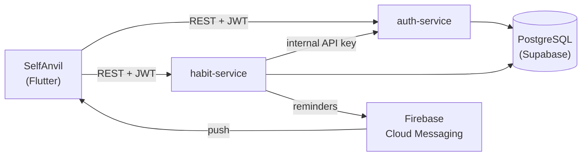

# habit-service

The habits and reminders service behind [SelfAnvil](https://github.com/MoiBeta/Auto-Admin-App), a tasks and habits app. It stores habits, subtasks and daily progress, and sends push reminders at each user's local time.

| Repository | What it is |
|---|---|
| [Auto-Admin-App](https://github.com/MoiBeta/Auto-Admin-App) | Flutter client for Android |
| [auth-service](https://github.com/MoiBeta/auth-service) | NestJS service for accounts and JWT sessions |
| **habit-service** (this one) | NestJS service for habits, subtasks and reminders |
| [selfanvil-infra](https://github.com/MoiBeta/selfanvil-infra) | Docker Compose, reverse proxy and deployment |

## Architecture



Both services run as Docker containers on an AWS Lightsail instance, with a managed PostgreSQL on Supabase. A Caddy reverse proxy is the only entry point: it terminates HTTPS and forwards each subdomain to its service, whose ports are not exposed to the internet.

This service does not issue tokens. It verifies the access tokens signed by `auth-service` with the shared `JWT_SECRET`, and calls `auth-service` over an internal endpoint to confirm that a user exists before creating data for them.

## Tech stack

NestJS 11, TypeScript, Prisma 6, PostgreSQL, Passport (JWT), `@nestjs/schedule`, Firebase Admin SDK, Swagger, Jest and Docker.

## API

Interactive documentation (Swagger UI) is live at [habits.selfanvil.app/docs](https://habits.selfanvil.app/docs). Every endpoint except the health check requires an access token.

| Method | Path | Description |
|---|---|---|
| `GET` | `/` | Health check |
| `POST` | `/habits` | Creates a habit with its subtasks and reminders |
| `GET` | `/habits?date=YYYY-MM-DD` | Lists the habits due on a day, with that day's progress |
| `POST` | `/habits/:id/toggle` | Marks a habit as done or not done for a day |
| `POST` | `/habits/:habitId/subtasks/sync` | Saves the state of a day's subtasks |
| `PATCH` | `/habits/:id` | Updates a habit, its subtasks and its reminders |
| `DELETE` | `/habits/:id` | Deletes a habit and its history |
| `POST` | `/devices/token` | Registers a device for push notifications |
| `DELETE` | `/devices/token` | Unregisters a device, for example on logout |

## Data model

| Model | Purpose |
|---|---|
| `Habit` | The template: name, priority, frequency and owner |
| `SubTask` | Checklist items of the template |
| `Reminder` | A local time of day, with the user's time zone |
| `HabitEntry` | The state of a habit in one period (one per habit and date) |
| `EntrySubTask` | A snapshot of the checklist for that entry |
| `DeviceToken` | An FCM token of one of the user's devices |

## Design decisions

- **Templates and entries are separate.** A habit is a template, and each period gets its own entry with a copy of the subtasks. Editing a habit's checklist changes today's entry and leaves past days as they were.
- **Entries are created on demand**, when the user first touches a habit in a period. Listing a day loads only the entry of that period, not the whole history.
- **Five frequencies with one rule each** ([frequency.utils.ts](src/habits/frequency.utils.ts)): daily, weekly, monthly and yearly habits repeat on the day they started; a one-time task is shown every day until it is completed.
- **Reminders fire in the user's local time.** A cron job runs every minute and finds the reminders due in each time zone. Reminders store an IANA time zone, so they follow daylight saving changes, and a time skipped by a clock change is sent right after it. Reminders saved before time zones were stored fall back to a fixed UTC offset.
- **The scheduler never overlaps itself.** If a run takes longer than a minute, the next tick is skipped.
- **Dead device tokens are cleaned up.** When Firebase reports that a token is no longer registered, it is deleted.
- **Users are a logical reference.** The two services have separate schemas, so `userId` is not a foreign key; ownership is checked on every request.

## Environment variables

Copy `.env.example` to `.env` and fill in the values.

| Variable | Description |
|---|---|
| `DATABASE_URL` | Pooled PostgreSQL connection, used at runtime |
| `DIRECT_URL` | Direct PostgreSQL connection, used for migrations |
| `JWT_SECRET` | Verifies access tokens. Must be the same as in `auth-service` |
| `INTERNAL_API_KEY` | Shared secret for calls to `auth-service`. Must be the same there |
| `AUTH_SERVICE_URL` | Base URL of `auth-service` |
| `GOOGLE_APPLICATION_CREDENTIALS` | Path to the Firebase service account JSON |
| `ALLOWED_ORIGINS` | Comma-separated list of allowed CORS origins |
| `PORT` | Port to listen on (defaults to 3000) |

## Running locally

Requirements: Node.js 20, a PostgreSQL database, a running `auth-service` and a Firebase service account for push notifications.

```bash
npm ci
cp .env.example .env
npx prisma migrate deploy
npm run start:dev
```

With Docker:

```bash
docker build -t habit-service .
docker run --env-file .env -p 3002:3000 \
  -v "$(pwd)/firebase-service-account.json:/run/secrets/firebase-service-account.json:ro" \
  -e GOOGLE_APPLICATION_CREDENTIALS=/run/secrets/firebase-service-account.json \
  habit-service
```

The Firebase credentials are mounted at runtime and are never part of the image. The container applies pending migrations before it starts.

## Tests

```bash
npm test
```

The suite covers the frequency rules, the habit logic, the reminder scheduler and its time zone handling, and the Firebase integration.

## CI/CD

[.github/workflows/ci-cd.yml](.github/workflows/ci-cd.yml) runs on GitHub Actions:

1. **Every pull request and every push to `main`:** install, generate the Prisma client, build and run the tests.
2. **Pushes to `main` only:** build the Docker image, publish it to GitHub Container Registry, then connect to the server over SSH and restart the service with the new image.

## Roadmap

- Fix the existing lint errors and enforce lint in CI.
